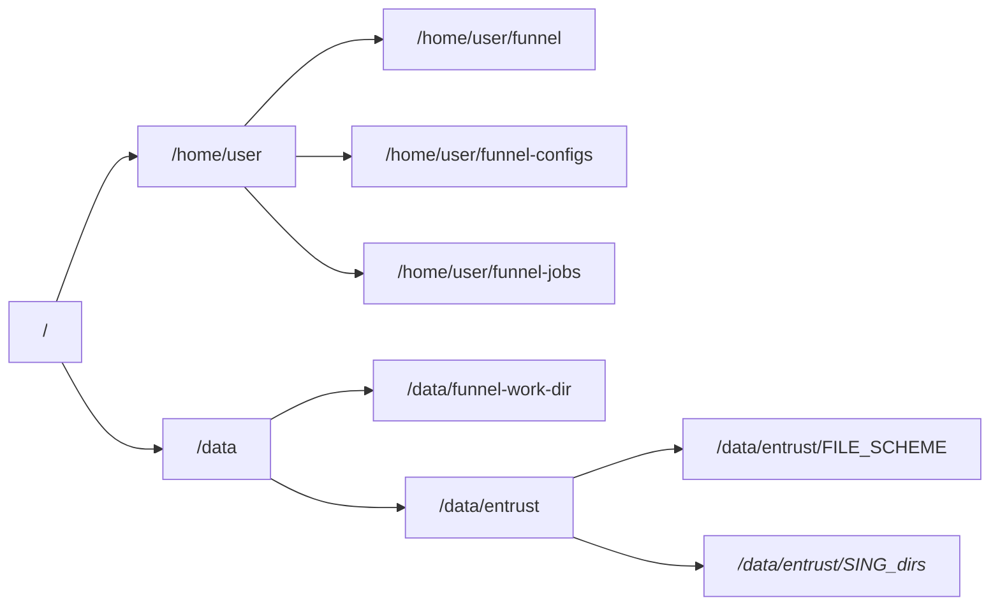
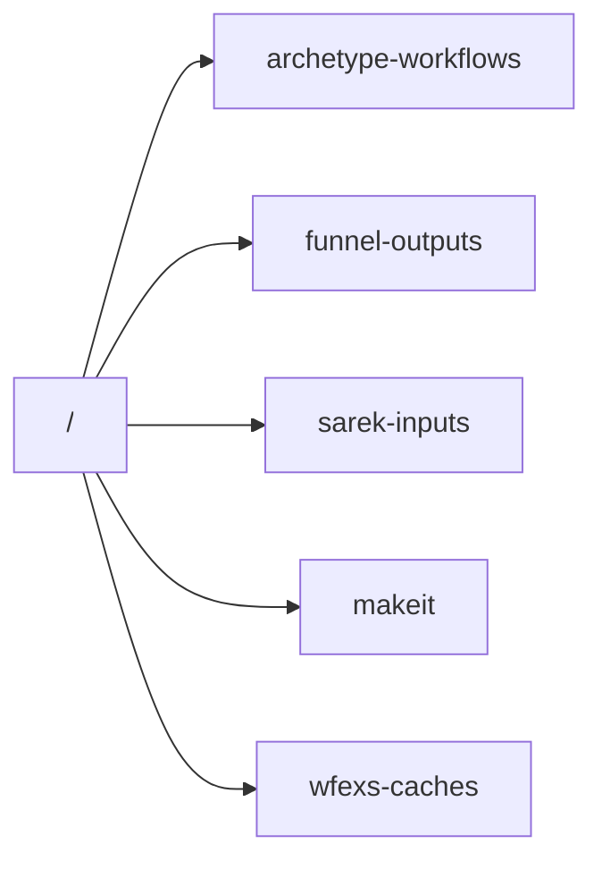
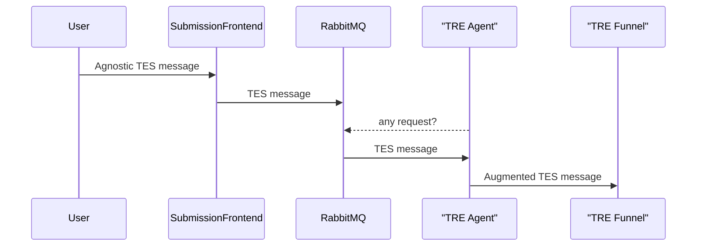
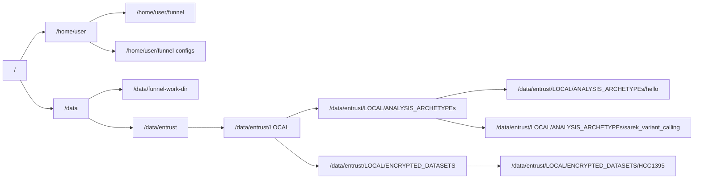

# EOSC-ENTRUST WP19-20-21 Workflow Processing Demonstrator

This repository describes a demonstration scenario to reproduce, using WfExS, the execution both of a test workflow execution and a whole variant calling analysis using Sarek within a TES job submitted to a properly deployed funnel TES service.

It also includes both the TES jobs used, as well as almost intact funnel configuration files.

## VM configuration

We have deployed the TES service within a 12 CPU, 48GB of RAM VM, with two volumes.

* The root one `/`, with 60GB. The home directory of the user running `funnel` will be there.
* The data one `/data`, encrypted at the OpenStack level, with 500GB of raw storage. The volume has two subdirectories, one called `/data/entrust` and another one called `/data/funnel-work-dir`. The first one will be used to hold both the granted subdirectory for the allowed `file` scheme transfers (`/data/entrust/FILE_SCHEME`) needed by the demo, and the hidden cache and working directories **only needed** by WfExS (`/data/entrust/SING_dirs`) in the hidden shared scenario (explained below).


When the examples based on an object store (like MinIO or RustFS) are used, next bucket layout is assumed:


* `archetype-workflows` bucket holds the WRROC for hello workflow and Sarek analysis. It can be read-only.
* `sarek-inputs` and `makeit` buckets hold the inputs both for Sarek analysis and the hello workflow. It can be read-only.
* `wfexs-caches` bucket holds pre-allocated caches needed both by the workflows and WfExS, assuming the TES service is running in an isolated environment. It can be read-only.
* `funnel-outputs` bucket will hold all the results pushed by TES jobs, so it should be writable with the configured S3 credentials on funnel.

The VM has Ubuntu 24.04, updated, with Docker installed following [official instructions](https://docs.docker.com/engine/install/ubuntu/). As we are using a non standard MTU (in our case, 1442) within our cloud environment, we had to create the `/etc/docker/daemon.json` config file with the next content:

```json
{
    "mtu": 1442,
    "default-network-opts": {
        "bridge": {
            "com.docker.network.driver.mtu": "1442"
        }
    }
}
```

Also, we added the user being used to run funnel to the `docker` group, so sudo is not needed to use docker command line.

As Ubuntu 24.04 and many other modern Linux distros are more restrictive about allowing the creation and usage of nested user namespaces (the technology which allows the process and capabilities isolation required by Docker, singularity and other solutions), it is needed to permanently disable the restrictions imposed by apparmor over unprivileged user namespaces. It was achieved creating the file `/etc/sysctl.d/99-unprivileged-userns.conf` with the next content:

```
kernel.apparmor_restrict_unprivileged_userns = 0
```

and the either reboot or run `sysctl -p`. Also, to allow hypothetical nested _singularity within singularity_ scenarios, it is needed to create or update file `/etc/fuse.conf` with the next content:

```
user_allow_other
```

Then, we are going to download the latest funnel version in the branch v0.11 (we used [v0.11.14](https://github.com/calypr/funnel/releases/tag/v0.11.14)). Basically, we fetched https://github.com/calypr/funnel/releases/download/v0.11.14/funnel-linux-amd64-v0.11.14.tar.gz , we created a folder called `funnel` within the home of the user, and we extracted the contents of the fetched archive within that folder.

The used WfExS-backend release was [version 1.0.10](https://github.com/inab/WfExS-backend/releases/tag/1.0.10) , as a [docker image](https://github.com/inab/WfExS-backend/pkgs/container/wfexs-backend/1220151481?tag=1.0.10) which is used by the TES jobs. Additionally, [Ubuntu 24.04 image](https://hub.docker.com/_/ubuntu) was needed for some pre and post execution tasks.

Depending on the chosen scenario, the configuration file needed for funnel is going to change.

## Needed downloadable contents

All the needed contents are available online:

* Workflow Run RO-Crate of the test hello workflow => https://doi.org/10.5281/zenodo.22640966

* Workflow Run RO-Crate of the Sarek nf-core workflow => https://doi.org/10.5281/zenodo.21134855

* Pre-populated WfExS caches with the shared datasets needed by the workflow, as well as the configuration files => https://doi.org/10.5281/zenodo.22641326
  * The minimal configuration files needed for the demonstration deployment within a containerised environment ([wfexs_min_config.tar.gz](https://zenodo.org/records/22641326/files/wfexs_min_config-20260831.tar.gz?download=1)).

  * The pre-populated side caches needed for the demonstration deployment within an isolated environment ([wfexs_side_caches.tar.gz](https://zenodo.org/records/22641326/files/wfexs_side_caches-20260831.tar.gz?download=1)).

  * The pre-populated dataset caches needed for the demonstration deployment within an isolated environment when either https://zenodo.org/records/21134855 or https://zenodo.org/records/22640966 WRROCs are used as the starting point ([wfexs_prepopulated_cache.tar.gz](https://zenodo.org/records/22641326/files/wfexs_prepopulated_cache-20260907.tar.gz?download=1)).

* Test input files (paired-end normal and tumour samples):
  * [s3://ngi-igenomes/test-data/sarek/SRR7890919_WES_HCC1395BL-EA_normal_1.fastq.gz](https://ngi-igenomes.s3.amazonaws.com/test-data/sarek/SRR7890919_WES_HCC1395BL-EA_normal_1.fastq.gz)
  * [s3://ngi-igenomes/test-data/sarek/SRR7890919_WES_HCC1395BL-EA_normal_2.fastq.gz](https://ngi-igenomes.s3.amazonaws.com/test-data/sarek/SRR7890919_WES_HCC1395BL-EA_normal_2.fastq.gz)
  * [s3://ngi-igenomes/test-data/sarek/SRR7890918_WES_HCC1395-EA_tumor_1.fastq.gz](https://ngi-igenomes.s3.amazonaws.com/test-data/sarek/SRR7890918_WES_HCC1395-EA_tumor_1.fastq.gz)
  * [s3://ngi-igenomes/test-data/sarek/SRR7890918_WES_HCC1395-EA_tumor_2.fastq.gz](https://ngi-igenomes.s3.amazonaws.com/test-data/sarek/SRR7890918_WES_HCC1395-EA_tumor_2.fastq.gz)

## Scenario 1: 5s-TES TRE

This scenario is the most secured one:



The TRE Agent must inject 4 environment variables through its DMN rules:
* `TRE_WORKFLOW_DIR`: The directory within the server where funnel is running, where all the usable analysis archetypes (sanctioned by the TRE operator) are available. This variable is used by the tweaked funnel configuration file, but it is not passed to the jobs.
* `TRE_INPUT_DIR`: The directory where the possible input datasets are available. There should be a separate directory for each different dataset. Each subdirectory representing a dataset must be encrypted using [gocryptfs](https://github.com/rfjakob/gocryptfs). This variable is used by the tweaked funnel configuration file, but it is not passed to the jobs.
* `TRE_INPUT_ID`: The identifier of the dataset to be used. It should be a relative route from `TRE_INPUT_DIR`.
* `TRE_INPUT_CREDENTIALS`: The password to decrypt the dataset `TRE_INPUT_ID` (indeed, the directory `${TRE_INPUT_DIR}/${TRE_INPUT_ID}`).

Then, the used funnel configuration file [funnel_wfexs-docker-privileged_v7_rw_cache.yaml](setup_scenarios/tre_config/funnel-configs/funnel_wfexs-docker-privileged_v7_rw_cache.yaml) is treating both `TRE_WORKFLOW_DIR` and `TRE_INPUT_DIR` variables, binding those host directories to `/workflows` and `/inputs` within the docker instances launched by funnel.

As you can see in the [TES message of this scenario](setup_scenarios/tre_config/funnel-jobs/template_complete_sarek_test_v4.json), the dataset decryption happens Within the job steps which need to use the decrypted files. It is assumed the first step is placing the credentials in a file, in order to avoid overspilling them over the TES service logs. The step must perform something like:

```bash
gocryptfs -nosyslog -ro -q -extpass 'cat /shared/.parameters/.credentials' ${ENCRYPTED_PATH}" "${DECRYPTED_PATH}"
```

The internal filesystem layout within the server where funnel lives is:



Each subdirectory within `ANALYSIS_ARCHETYPE` has next contents:

* `funnel_tre_wfexs_restricted.yaml`: WfExS configuration file describing this analysis. This one is referred by the job itself, to build the content of `WFEXS_CONFIG_FILE` environment variable. The working directory within the file, under `workDir`, is hardcoded to `/shared/wfexs-backend-TRE-WORKDIR` (a path which must exist within the TES jobs).
* `local_container_wfexs.yaml.key`: This one is referred by `funnel_tre_wfexs_restricted.yaml`.
* `local_container_wfexs.yaml.pub`: This one is referred by `funnel_tre_wfexs_restricted.yaml`.
* `wfexs-backend-container-cache`: This one is referred by `funnel_tre_wfexs_restricted.yaml`. Its contents come from `wfexs_prepopulated_cache.tar.gz` (whose link is available above). It contains the prepopulated public datasets needed by the analysis workflow. 
* `side_caches`: This one is referred by the job itself to build the environment variable `XDG_CACHE_DIR`. WfExS caches there RO-Crate profile declarations, lists of words and lists of licences, used both to validate WRROCs, generate random job names and assess selected licences from SPDX short names.
* `wrroc.zip`: The Workflow Run RO-Crate file which describes a previous execution of the analysis workflow. It contains default parameter values.

Each subdirectory within `ENCRYPTED_DATASETS` is encrypted using gocryptfs.

## Scenario 2: isolated TES service with no shared WfExS cache directories:

This scenario is one of the most secured ones, but it requires to include as input both the workflow RO-Crate and each of the prepared WfExS cache and configuration archives.

The used funnel configuration file is [funnel_wfexs-docker-privileged_v4_rw_cache.yaml](setup_scenarios/default_config/funnel-configs/funnel_wfexs-docker-privileged_v4_rw_cache.yaml) for a singularity within docker approach.

We have TES examples based both on local files, as well as an object store:
* **Hello workflow**: [local](setup_scenarios/default_config/funnel-jobs/template_complete_hello_test_v2.json) and [object store](setup_scenarios/default_config/funnel-jobs/template_complete_hello_test_v3.json).
* **Sarek analysis**: [local](setup_scenarios/default_config/funnel-jobs/template_complete_sarek_test_v2.json) and [object store](setup_scenarios/default_config/funnel-jobs/template_complete_sarek_test_v3.json).

## Scenario 3: hidden shared WfExS cache directories within the TES service:

This scenario internally hardcodes both the WfExS configuration files and cache directories, as well as the parent working directories.

The used funnel configuration file is [funnel_wfexs-docker-privileged_v3_rw_cache.yaml](setup_scenarios/hidden_shared_config/funnel-configs/funnel_wfexs-docker-privileged_v3_rw_cache.yaml) for a singularity within docker approach.
